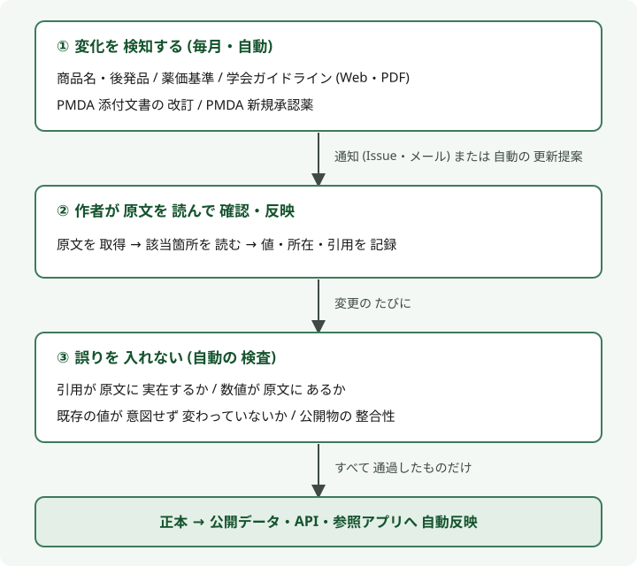

# 休薬情報データベース (Kyuyaku Data)

手術・処置の前や 造影 CT 検査の前に「どの薬を、 何日前から 休薬するか」 を、 学会ガイドラインや PMDA 添付文書などの 一次資料に基づいて 整理した **オープンデータ** です。 参照アプリ・API・全件データを 無料で 公開しています。

| | |
|---|---|
| **参照アプリ** | **https://numero-uno-jpn.github.io/kyuyaku-data/** (ブラウザで そのまま使えます。 登録不要) |
| **使い方** | [参照アプリの 使い方 (画面付き)](https://numero-uno-jpn.github.io/kyuyaku-data/guide.html) |
| **API** | `https://numero-uno-jpn.github.io/kyuyaku-data/v1/` (静的 JSON、 [仕様](docs/api.md)) |
| **全件データ** | [`data/washout_public_v1.json`](data/washout_public_v1.json) |
| **作者** | 梅谷 直亨 (Naoyuki Umetani、 外科医) |
| **ライセンス** | データ [CC BY 4.0](LICENSE-DATA) (引用部分を除く) / コード [MIT](LICENSE) |

> ⚠ **本データは 意思決定支援のための 参考情報です。** 最終的な 休薬・再開の 判断は、 患者の状態・手術や処置の内容・血栓と出血のリスクを 踏まえて 担当の医療者が 行ってください。 無保証です。 詳しくは [DISCLAIMER.md](DISCLAIMER.md)。

## 簡単な使い方

1. [参照アプリ](https://numero-uno-jpn.github.io/kyuyaku-data/) を 開き、 検索欄に 薬の名前を 入れます。 一般名・商品名・後発品名の どれでも、 一部だけでも、 ひらがなでも、 多少の 打ち間違いや 表記ゆれ (「アスピリソ」「リバロキサバン」) でも 検索できます。 何も 当たらない 時は 「もしかして」 の 候補を 出します。
   `https://numero-uno-jpn.github.io/kyuyaku-data/?q=アスピリン` のように URL でも 検索できます。
2. 薬効分類の ボタン (抗血栓薬・糖尿病薬 など) で 絞り込むこともできます。
3. カードを 押すと、 休薬日数 (安全側の値)、 ガイドライン別の値と 値の出どころ、 根拠の 引用または抜粋、 出典 (一次資料へのリンク) が 表示されます。
4. 「内容をコピー」 で 要点を テキストで、 「リンクをコピー」 で その薬の ページの URL を 取り出せます。

詳しくは [使い方ページ](https://numero-uno-jpn.github.io/kyuyaku-data/guide.html) を ご覧ください。

---

## 目次

1. [作者より — このデータを作った理由](#作者より--このデータを作った理由)
2. [目的](#目的)
3. [収録範囲](#収録範囲)
4. [データの作り方](#データの作り方)
5. [データを 正しく・網羅的に 更新し続ける仕組み](#データを-正しく網羅的に-更新し続ける仕組み)
6. [データ構造](#データ構造)
7. [API・全件データの使い方](#api全件データの使い方)
8. [利用上の注意 (制限事項)](#利用上の注意-制限事項)
9. [帰属表示・引用・ライセンス](#帰属表示引用ライセンス)
10. [更新と版](#更新と版)
11. [誤りの報告](#誤りの報告)
12. [リポジトリの構成](#リポジトリの構成)

---

## 作者より — このデータを作った理由

ある朝、 手術室の入口で 患者さんの お薬手帳を めくっていて、 数週間前の 術前外来で 「休薬を」 と 確かに 指示したはずの 抗血小板薬の ページに、 わずか 三日前の 調剤印が 押されているのに 気づきました。 患者さんは 手術の 直前まで その薬を 飲み続けていたのです。 安全を考え、 その日の手術は 直前で 中止せざるを 得ませんでした。 患者さんと ご家族の 落胆、 組み直しになった 手術室の 予定 — あの朝の 冷ややかな感覚が、 このデータを 作り始めた 原点です。

休薬の 確認は、 現場の 努力だけでは 防ぎきれない 構造的な 難しさを 抱えています。

- **薬の 名前が 多すぎる。** 1 つの 一般名に 先発品・後発品・配合剤の 商品名が 何十も 並びます。 「タケルダ」 に アスピリンが 含まれていると 即座に 分かる人は 多くありません。 休薬対象を 覚えるとは、 その何倍もの 商品名を 一般名と 結びつけて 覚え続けることです。
- **知見が 絶えず 更新される。** SGLT2 阻害薬 (周術期の 正常血糖ケトアシドーシス) や GLP-1 受容体作動薬 (麻酔導入時の 誤嚥) のように、 数年前には 意識されていなかった 推奨が 次々に 加わります。 DOAC は 薬ごと・腎機能ごとに 休薬期間が 違い、 ガイドラインも 学会ごと・版ごとに 値が 異なります。
- **チェックリストには 限界がある。** 網羅的な リストは 何ページにもなり 外来の 数十秒では 引けず、 一枚の 簡潔版は 網羅性と 最新性を 犠牲にします。 数年前に 作られたきりの リストが 現役で 使われている 現場も あります。
- **個人の 気合に 頼っている。** 看護師・麻酔科医・主治医が 何重に 確認しても、 「誰かが 見ているはず」 という 隙間から 漏れます。 漏れの 教訓は 個人の メモに 書き溜められ、 共有されないまま 消えていきます。

一剤ごとに 最新の 添付文書と 複数の ガイドラインを 突き合わせ、 どの資料の どこに 書いてあるかを 確かめる — この作業を、 医療者 一人ひとりが 毎回 繰り返すのは 無駄で、 危険でもあります。 そこで、 **根拠を たどれる 形で 整理した 休薬データを 一度 作り、 正しく 更新し続け、 誰でも 使えるように 公開する** ことにしました。

作るのは 想像以上に 骨の折れる 作業でした。 同じ薬でも ガイドラインごとに 出血リスクの 分類や 日数が 異なり、 版の 改訂で 値が 変わります。 機械的な 抽出 (AI による 読み取りを 含む) では、 表の 番号の ずれや、 添付文書に 書かれていない 日数を 添付文書由来と してしまう 誤りが 実際に 数多く 見つかりました。 そのため、 根拠として 「確認済み」 と するのは **作者が 原文を 実際に 読んで 照合した ものだけ** と 決め、 一件ずつ 原文に 当たり直しています。

休薬の 判断そのものは、 患者さん ごとの 病態を 踏まえた 医療者の 仕事です。 このデータが 担いたいのは、 その前段の 「思い出す」「調べ直す」 手間と 見落としを 減らすことです。 全国の どこかで、 一件でも 手術の延期や 合併症を 防ぐ 助けに なれば 幸いです。

## 目的

周術期の 休薬判断は、 薬の種類・手術の出血リスク・麻酔の方法 (全身麻酔か 区域麻酔か)・腎機能などによって 変わり、 根拠となる ガイドラインも 学会ごと・版ごとに 異なります。 現場では 複数の 資料を 突き合わせる 手間がかかり、 確認漏れは 手術の延期や 出血・血栓の 合併症に つながります。

このデータベースは、
- 薬ごとに **ガイドライン別の値を 並べて** 比べられる
- どの値も **一次資料の どこに 書いてあるか** (資料名・頁・表、 PDF の該当頁へのリンク) を たどれる
- その値が **ガイドラインに 直接書かれた値か、 クラス推奨の当てはめか、 計算値か** が 分かる

ことを 目指して 作っています。 医療安全に 役立つよう、 誰でも 自由に 使える形で 公開しています。

## 収録範囲

- **対象**: 周術期 (手術・処置・区域麻酔) と 造影 CT 検査前の **休薬** に関わる薬剤。 抗血栓薬、 糖尿病薬、 降圧・利尿薬、 抗リウマチ薬・免疫抑制薬 (生物学的製剤・JAK 阻害薬を含む)、 骨粗鬆症薬、 ホルモン製剤、 抗がん剤の一部、 精神・神経系、 サプリメントなど。 収載数は [`v1/meta.json`](https://numero-uno-jpn.github.io/kyuyaku-data/v1/meta.json) の `drug_count` を 参照してください。
- **主な一次資料** (例):
  - 日本: 日本麻酔科学会・日本区域麻酔学会・日本ペインクリニック学会「抗血栓療法中の区域麻酔・神経ブロックガイドライン」 (2016 初版・2026 改訂第 2 版)、 日本循環器学会 (抗血栓療法・不整脈薬物治療・SGLT2 阻害薬)、 日本消化器内視鏡学会、 日本糖尿病学会、 日本腎臓学会、 日本リウマチ学会、 日本皮膚科学会、 顎骨壊死検討委員会 ポジションペーパー、 日本医学放射線学会 (造影剤)、 PMDA 添付文書
  - 海外: ACC/AHA 2024 (非心臓手術の周術期管理)、 ESC 2022、 ASRA 2018、 ACR/AAHKS 2022、 BSR 2019、 KDIGO 2022、 ASA (GLP-1 受容体作動薬・サプリメント)、 FDA 添付文書 など
- **含まないもの**: 薬物相互作用、 術後の 再開時期の 網羅的な情報、 小児の用量別の扱い、 一次資料の 全文。

## データの作り方

1. **一次資料からの 抽出**: ガイドライン・添付文書から、 薬ごとの 休薬日数 (出血リスク別)・条件 (用量・腎機能等)・根拠の記載箇所を 抽出します。 ガイドラインの 版ごと (初版・改訂版) に 分けて 記録しています。
2. **原文との 照合**: 作者が 原文を 確認できた 出典は、 確認状況 (`verification_status`) を `verified` とし、 所在 (頁・表) と 引用または抜粋を 記録しています。
3. **表示用の値 (安全側) の 決定**: 一覧や 参照アプリで 大きく 表示する `display_*` は、 次の 順で 決めた **安全側 (長い方) の値** です。
   1. 現行版の ガイドラインの 値の 最大値 (旧版は 除外)
   2. ガイドラインに 記載が なければ、 PMDA 添付文書の 値の 最大値
   3. どちらも なければ、 作者の 採用値
4. **値の出どころの 区別** (`value_derivation`):

   | 値 | 意味 |
   |---|---|
   | `direct` | ガイドラインが その薬の 値を 直接記載 |
   | `class` | ガイドラインは 薬効クラス (例: 「SGLT2 阻害薬」) 単位で 推奨しており、 その値を 個々の薬に 当てはめた |
   | `derived` | ガイドラインの 「半減期の N 倍」 等の ルールから 作者が 計算した値 |
   | (なし) | 未分類 (PMDA 添付文書などの 手入力値) |

   **`direct` 以外は、 ガイドラインに その薬の 日数が 明記されているわけでは ありません。**
5. **出典の 確認状況** (`references[].verification_status`):

   | 値 | 意味 |
   |---|---|
   | `verified` | 作者が 原文を 確認し、 所在と 引用または抜粋を 記録した 出典 |
   | `helper_link` | 補助的な 参照先 (専門家の合意文書・関連資料など)。 日数の根拠としての 確認は していない |
   | `landing_only` | 資料の 入口ページへの リンク (該当箇所までは 特定していない) |
   | `unverified` | 未確認 |
6. **引用または抜粋**: 根拠の 透明性のため、 一次資料からの 引用または抜粋を 載せています (和文 300 字 / 英文 600 字を 超えるものは 抜粋、 ` … ` は 中略)。 一部、 参考資料・作者による 注記を 含みます。 正確な 記載は 必ず 原典で 確認してください。

## データを 正しく・網羅的に 更新し続ける仕組み

休薬データは 一度 作って 終わりでは ありません。 新しい 商品名・後発品の 発売、 ガイドラインの 改訂、 添付文書の 改訂、 新薬の 承認 — どれか 1 つを 見逃しても、 データは 静かに 古くなります。 一方で、 更新の たびに 誤りが 混入する 危険も あります。 このデータベースでは、 **「変化を 漏れなく 検知する」 仕組み** と **「誤りを 入れない」 仕組み** を 組み合わせ、 最後は **作者が 原文を 読んで 確認する** という 三段構えで 運用しています。

<p align="center"></p>

### ① 変化を 漏れなく 検知する (毎月・自動)

| 監視対象 | 頻度 | 何を 検知し、 どうするか |
|---|---|---|
| **商品名・後発品** (KEGG 医薬品データベース) | 毎月 1 日 | 収載薬の 新しい 商品名・後発品名を 取得し、 **追加のみ** の 更新提案を 自動で 作成。 既存の 確定済み 名称の 削除・格下げが あれば 提案自体を 止める (安全装置)。 すべての 自動検査に 合格したものだけを 取り込み |
| **薬価基準** (厚生労働省) | 毎月 1 日 | 薬価基準 収載品目と 照合し、 新規収載・名称変更などの 差分を レポートとして 通知 |
| **学会ガイドラインの Web ページ** | 毎月 5 日 | 各学会の ガイドライン掲載ページの 変化 (新版の 掲載など) を 検知して 通知。 新版の 候補は 抽出の 下準備まで 自動で 行う |
| **ガイドライン PDF** | 毎月 7 日 | 参照している PDF の サイズ・更新日時・ファイル名の 変化から 改訂を 検知して 通知 |
| **PMDA 添付文書** | 毎月 9 日 | 参照している 添付文書 PDF の 内容 (ハッシュ値) を 比較し、 改訂を 検知したら 最新版を 取得して 通知 |
| **PMDA 新規承認薬** (PMDA メディナビ) | 配信の たび | 承認情報の メールを 受信するたびに 自動で 保存 (蓄積)。 周術期の 休薬に 関わる 新薬を 自動で 判定・通知する 仕組みは 準備中 |

検知は 自動ですが、 **休薬日数を 自動で 書き換えることは しません**。 値の 変更は 必ず ② を 経ます。

### ② 作者が 原文を 読んで 確認・反映する

- 通知を 受けたら、 改訂後の 原文 (ガイドライン・添付文書) を 取得し、 該当箇所を **作者が 自分で 読んで** 確認します。 要約・検索結果・AI の 読み取り結果・記憶は 根拠に しません。
- 値と あわせて **所在 (頁・表番号) と 引用または抜粋** を 記録します。 引用は 原文と 機械的に 照合し、 表や 項目番号は PDF を 画像で 確認します。
- ガイドラインは **版ごとに** 記録し、 旧版の値は 履歴として 残したうえで 表示用の値の 計算から 外します。
- 「確認済み (`verified`)」 に できるのは、 国内外の 添付文書と 学会・公的機関の 正式な ガイドラインだけです。 専門家の 合意文書などの 実務資料は 参考 (`helper_link`) に とどめ、 確認状況を 引き上げません。
- 根拠の ない 日数を 出典の 追加だけで 「確認済み」 に 見せることは しません。

### ③ 誤りを 入れない (変更の たびに 自動で 検査)

| 検査 | 内容 |
|---|---|
| **引用の 実在検査** | 記録した 引用が、 一次資料から 抽出した 本文に 実際に 存在するか |
| **数値の 逆照合** | 休薬日数などの 数値が、 原文中で その薬の 名前と 一緒に 現れるか。 根拠の 見当たらない 数値 (読み取りの 誤りの 疑い) が 新たに 出たら 失敗に する |
| **値の 回帰検知** | 全薬剤・全ガイドラインの 値を 記録した 基準と 突き合わせ、 意図しない 値の 変化を 検出。 別名の 衝突 (同じ名前が 複数の 薬に 当たる) も 検出 |
| **添付文書の 抽出崩れ検知** | 2 段組 PDF の 読み取りで 起きる 文字の 混線などが 紛れ込んでいないか |
| **公開データの 検査** | 内部用の 項目が 混入していないか、 引用が 上限内か、 公開データが 正本と 一致しているか |
| **画面の 自動テスト** | データの 変更で 画面が 壊れていないか |

一つでも 不合格なら 反映されません。 すべてに 合格した 変更だけが、 正本 → 公開データ (`data/`)・API (`v1/`)・参照アプリへと **自動で 反映** されます。 反映の 履歴は [コミット履歴](https://github.com/numero-uno-jpn/kyuyaku-data/commits/main) で 確認できます。

### 利用者からの 報告

それでも 誤りや 古い記載が 残る 可能性は あります。 気づいた点は [誤りの報告](https://github.com/numero-uno-jpn/kyuyaku-data/issues/new?template=correction.md) から、 根拠となる 資料と 頁を 添えて お知らせください。 報告も ② と 同じ手順 (作者が 原文で 確認) を 経て 反映します。

## データ構造

`data/washout_public_v1.json` は `_meta` (版・ライセンス・免責) と `drugs` (薬ごとの配列) から なります。 1 薬の例 (アピキサバン、 一部 省略):

```json
{
  "name": "アピキサバン",
  "category": "DOAC (直接経口抗凝固薬 / FXa阻害薬)",
  "aliases": ["apixaban"],
  "brand_names": ["エリキュース錠2.5mg", "エリキュース錠5mg"],
  "surgery": {
    "required": true,
    "display_high_risk_days_before": 3,
    "display_low_risk_days_before": 1,
    "high_risk_surgery_examples": ["脊髄外科", "脳神経外科", "心臓外科"],
    "low_risk_surgery_examples": ["皮膚生検", "歯科抜歯", "白内障手術"],
    "note": "…"
  },
  "contrast_ct": { "required": false, "display_days_before": null },
  "guideline_variations": {
    "surgery": [
      {
        "source": "JSA・JSRA・JSPC 2026 改訂第 2 版",
        "high_risk_days": 3,
        "low_risk_days": 0,
        "value_derivation": "direct",
        "dose_dependent_summary": "標準 or 高用量 3日, 低用量 1日",
        "source_location": "p.25 表 9 + p.26 解説 + 表 11",
        "source_url": "https://anesth.or.jp/files/pdf/guideline_kouketsusen_shinkeiblock.pdf",
        "quote_excerpt": "…"
      }
    ],
    "contrast_ct": []
  },
  "references": [
    {
      "source": "JSA・JSRA・JSPC",
      "title": "抗血栓療法中の区域麻酔・神経ブロックガイドライン",
      "year": 2016,
      "url": "https://anesth.or.jp/files/pdf/guideline_kouketsusen.pdf#page=35",
      "verification_status": "verified",
      "location_in_source": "表 7 (p.23) + 5 章 推奨 (p.22)",
      "quote_excerpt": "…"
    }
  ]
}
```

主な項目:

| 項目 | 意味 |
|---|---|
| `surgery.display_high_risk_days_before` / `display_low_risk_days_before` | 出血リスクの 高い / 低い 手術の 前の 休薬日数 (**安全側の値。 利用時は こちらを 推奨**)。 `0` は 休薬不要、 `null` は 記載なし |
| `surgery.high_risk_days_before` / `low_risk_days_before` | 作者の 採用値 (表示用の値の 決定に 使う 第 3 候補) |
| `contrast_ct.required` / `display_days_before` | 造影 CT 前の 休薬の 要否 / 日数 |
| `guideline_variations.surgery[]` / `contrast_ct[]` | ガイドライン別の値。 `high_risk_days` / `low_risk_days` / `days`、 `value_derivation`、 `dose_dependent_summary` (用量・腎機能別の要約)、 `version_label` / `version_year`、 `source_location`、 `source_url`、 `quote_excerpt` |
| `references[]` | 出典。 `source` / `title` / `year` / `url` / `verification_status` / `location_in_source` / `quote_excerpt` / `quote_translation_excerpt` (英文の和訳) |
| URL の `#page=N` | PDF の 該当頁 (PDF の 頁番号で、 印刷頁とは 異なることがある) |

すべての項目の 説明は [docs/api.md](docs/api.md) に あります。

## API・全件データの使い方

| URL (`https://numero-uno-jpn.github.io/kyuyaku-data/` からの パス) | 内容 |
|---|---|
| `v1/meta.json` | データの版・更新日・収載数・ライセンス・免責 |
| `v1/drugs.json` | 全薬剤の 一覧 (休薬日数の要約と 詳細ファイルの パス `file`) |
| `v1/drugs/{一般名}.json` | 1 薬の 詳細 |
| `v1/lookup.json` | 一般名・別名・商品名・後発品名 (小文字) → 一般名の 配列 |
| `v1/search-index.json` | あいまい検索用の 索引 (`assets/search.js` と 組み合わせる) |
| `data/washout_public_v1.json` | 全件 (1 ファイル) |

- 認証・利用登録は 不要です。 どのサイトからでも 呼び出せます (CORS: `Access-Control-Allow-Origin: *`)。
- **商品名から 引くとき**は、 `lookup.json` で 一般名を 得てから `drugs/{一般名}.json` を 取得します。 1 つの 商品名が 複数の 一般名に 対応する場合 (配合剤 等) は 配列に 複数 入ります。

```bash
BASE=https://numero-uno-jpn.github.io/kyuyaku-data/v1

curl $BASE/drugs/アピキサバン.json
curl -s $BASE/lookup.json | jq -r '.lookup["エリキュース錠5mg"][]'      # → アピキサバン

# 全件
curl -O https://raw.githubusercontent.com/numero-uno-jpn/kyuyaku-data/main/data/washout_public_v1.json
```

```js
// ブラウザ / Node.js
const BASE = 'https://numero-uno-jpn.github.io/kyuyaku-data/v1';
const { lookup } = await (await fetch(`${BASE}/lookup.json`)).json();
const [name] = lookup['エリキュース錠5mg'.toLowerCase()] ?? [];
const { drug } = await (await fetch(`${BASE}/drugs/${encodeURIComponent(name)}.json`)).json();
console.log(drug.surgery.display_high_risk_days_before);   // 3
```

### あいまい検索

サーバー側の `?q=` 検索は ありませんが、 参照アプリと 同じ あいまい検索の 関数 [`assets/search.js`](assets/search.js) (外部ライブラリなし) と 索引 `v1/search-index.json` で、 打ち間違い・表記ゆれに 強い 検索が できます。 下の例は ブラウザ用です (Node.js では `search.js` を ダウンロードして `import` してください)。

```js
import { buildIndex, search } from 'https://numero-uno-jpn.github.io/kyuyaku-data/assets/search.js';
const BASE = 'https://numero-uno-jpn.github.io/kyuyaku-data/v1';
const index = buildIndex((await (await fetch(`${BASE}/search-index.json`)).json()).drugs);
search(index, 'アスピリソ');   // → [{ name: 'アスピリン', score: 63, term: 'アスピリン', kind: 'typo' }]
```

吸収する 違いと 得点の 詳細は [docs/api.md](docs/api.md#あいまい検索-q-の-代わり) を 参照してください。

## 利用上の注意 (制限事項)

- **一般的な目安です。** 個々の患者 (腎機能、 血栓リスク、 ステント留置後の期間、 用量など) に 応じた 判断が 必要です。 ガイドラインの 条件 (用量別・腎機能別) は `dose_dependent_summary` や 引用を 確認してください。
- **出血リスクの 分類は ガイドラインごとに 異なります。** 区域麻酔・神経ブロックの ガイドラインと 一般手術・内視鏡の ガイドラインでは 想定する 手技が 違います。 表示用の値は それらの 最長値 (安全側) です。
- **休薬しないことが 推奨される 場合が あります** (例: 冠動脈ステント留置後の アスピリン継続)。 日数だけで 判断せず、 補足と ガイドラインの 推奨文を 確認してください。
- **更新の 遅れが ありえます。** ガイドラインや 添付文書の 改訂から 反映までに 時間差が あります。 データの版と 更新日は `meta.json` で 確認できます。
- **医療機器 (プログラム医療機器) では ありません。**

## 帰属表示・引用・ライセンス

**帰属表示** (データを 利用・再配布する 際に 表示してください):

```
梅谷 直亨, 休薬情報データベース (Kyuyaku Data), https://github.com/numero-uno-jpn/kyuyaku-data
```

**論文・学会発表での 引用**: [CITATION.cff](CITATION.cff) の 情報を 使い、 **データの版** (`meta.json` の `data_version`) と **参照日** を 併記してください。 GitHub の 「Cite this repository」 からも 書式を 取得できます。

**ライセンス**:
- データ (`data/`、 `v1/`): [CC BY 4.0](LICENSE-DATA)。 帰属表示を すれば、 商用を含め 自由に 利用・改変・再配布できます。
- **例外**: `quote_excerpt` / `quote_translation_excerpt` は 各出典 (学会ガイドライン・添付文書 等) の 著作物からの 引用または抜粋であり、 **CC BY 4.0 の 対象外** です (著作権法 32 条に基づく 引用。 著作権は 各権利者に 帰属)。 再利用する 場合は 出典を 明示し、 各権利者の 条件に 従ってください。
- コード (`code/`、 `assets/`): [MIT](LICENSE)

## 更新と版

- データは 作者が 管理する 正本から 自動で 生成・同期されます。 更新の たびに `data_version` / `data_updated_at` が 変わります。
- 更新の 仕組みは [データを 正しく・網羅的に 更新し続ける仕組み](#データを-正しく網羅的に-更新し続ける仕組み) を 参照してください。
- 変更履歴は このリポジトリの [コミット履歴](https://github.com/numero-uno-jpn/kyuyaku-data/commits/main) で 確認できます。
- 学会発表などの 節目に リリース (版の固定) を 作成します。

## 誤りの報告

内容の誤りや 古い記載に 気づいた場合は、 [Issue (誤りの報告)](https://github.com/numero-uno-jpn/kyuyaku-data/issues/new?template=correction.md) から お知らせください。 **根拠となる 一次資料の 名称・URL・頁** を 添えてください。 作者が 原文を 確認したうえで 反映します。

本リポジトリは 正本からの 自動生成のため、 Pull Request は 受け付けていません。

## リポジトリの構成

```
index.html, guide.html, assets/   参照アプリと 使い方ページ (GitHub Pages)
v1/                        静的 JSON API (meta / drugs / drugs/{一般名} / lookup)
data/                      全件データ washout_public_v1.json
docs/api.md                API・項目の 仕様
code/                      公開データの 生成ロジックと PHP 版 API の 参照実装 (透明性のための 掲載。 正本データは 含まない)
LICENSE, LICENSE-DATA      ライセンス (コード MIT / データ CC BY 4.0)
DISCLAIMER.md              免責事項
CITATION.cff               引用情報
```

---

作者: 梅谷 直亨 (Naoyuki Umetani)。 ご意見・誤りの報告は [Issue](https://github.com/numero-uno-jpn/kyuyaku-data/issues) へ。
